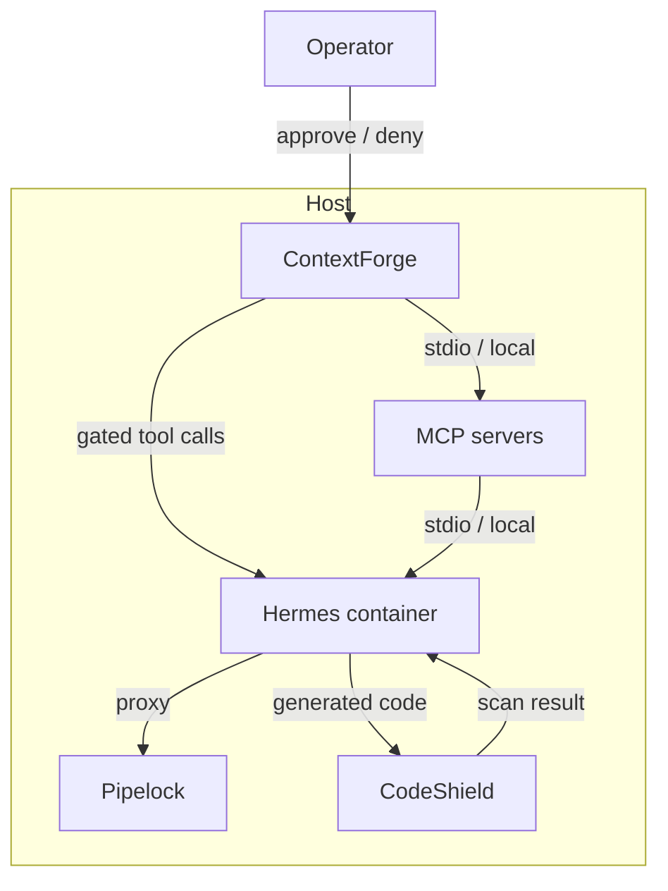

# Research summary: Hardening Hermes with MCP-mediated capabilities

This is the single-file summary of all research conclusions from the `2026-06-27.rbac` research directory. It consolidates the settled decisions, architecture, MCP server selections, and open items into one reference for the guide update work.

## 1. Problem statement

Hermes Agent ships with ~71 native tools across ~29 toolsets, all running in-process inside the same Python interpreter as the agent loop, skills, plugins, and configuration. Its own `SECURITY.md` states that the only real security boundary is the operating system. The hardening strategy is not "add policy on top of Hermes" but "disable or relocate almost all of Hermes' native power, then put trusted proxies and sandboxes in front of the small set of capabilities that remain."

## 2. Architecture

## 3. Settled decisions

### 3.1 Keep Hermes despite its security liabilities

Hermes' messaging gateway, persistent memory, auto-generated skills, and model-agnostic deployment are irreplaceable without rebuilding them. Treat Hermes as an untrusted workload inside OS/container isolation.

### 3.2 ContextForge is the MCP gateway

Apache 2.0, purpose-built for MCP, native RBAC/ABAC, single-container SQLite mode, 35+ security plugins. Kong Gateway is a fallback only with a Kong Enterprise/Konnect license.

### 3.3 `pre_tool_call` and in-process plugins are not an enforcement boundary

They run inside the same Python interpreter as the agent and can be bypassed by `execute_code`, `terminal`, or a malicious skill. Use only for logging/telemetry.

### 3.4 Pipelock is the egress control; CrabTrap is out of scope

Pipelock provides deterministic egress control and DLP. CrabTrap's LLM judge adds cost/latency/PostgreSQL overhead that a single-host deployment does not need.

### 3.5 LlamaFirewall CodeShield scans generated code

CodeShield combines regex screening with Semgrep-based AST analysis, covers 8 languages and 50+ CWEs. Runs as a separate container. PromptGuard and Agent Alignment Checks are off by default.

### 3.6 No OPA and no Casbin

ContextForge's native RBAC/ABAC is the policy layer. If it proves insufficient, the Cedar plugin is the next step. OPA and Casbin are explicitly out of scope.

### 3.7 No credential broker

No ClawShell, no Infisical Agent Vault. Credentials live in the Hermes/MCP-server environment as tightly scoped static tokens. Accepted residual risks: credential possession, semantic misuse on allowed endpoints, no short-lived tokens, LLM-channel DLP lost. Mitigations: Pipelock DLP/egress, ContextForge tool-level policy, provider-side scoping.

### 3.8 Runtime integrity

- No read-only mounts for `~/.hermes/plugins/` and `~/.hermes/skills/`.
- `execute_code` is disabled entirely. Replaced by `vndee/llm-sandbox` MCP server.
- `terminal` is disabled entirely. Replaced by the same `vndee/llm-sandbox` MCP server.
- Plugin/skill integrity relies on operator install from trusted sources plus periodic audit.

### 3.9 High-risk native toolsets must be disabled or replaced

~42 tools across Critical/High blast-radius classes must be removed or relocated before the MCP proxy becomes meaningful. See `17-hermes-native-tools-and-mcp-replacements.md` for the full inventory.

### 3.10 MCP server selections finalized

See [24-mcp-server-selection.md](./24-mcp-server-selection.md) for the full matrix.

**Decided for first guide version (6 picks):**

1. `vndee/llm-sandbox` — code execution + shell
2. `tadmstr/searxng-mcp` — web search + fetch
3. `unclecode/crawl4ai` — web crawl/fetch
4. `kepano/obsidian-skills` — Obsidian CLI (skills, not MCP)
5. `cyanheads/obsidian-mcp-server` — Obsidian vault RBAC
6. `github/github-mcp-server` — GitHub

**Deferred to future guide version:**

7. `rust-mcp-stack/rust-mcp-filesystem` — filesystem. Deferred to reduce guide complexity; Hermes' native file tools stay enabled in v1. See §6.3.
8. `taylorwilsdon/google_workspace_mcp` — email + Google Workspace (Gmail, Calendar, Drive, Docs, Sheets, Slides, Forms, Tasks, Contacts, Chat, Apps Script, Search). Email is out of scope for this update. See §6.2.

### 3.11 Filesystem MCP server pick — DEFERRED

**Pick:** `rust-mcp-stack/rust-mcp-filesystem` (MIT, 159 stars, Rust single binary, read-only by default, tool disabling, MCP Roots, ZIP support, 28 releases).

Deferred to a future guide version to reduce complexity. For v1, Hermes' native file tools stay enabled (in-process): the read-only rootfs confines writes to the state volume and the container remains the blast-radius boundary. What v1 gives up vs. the MCP server is ContextForge's audit logging, rate limiting, and optional tool denylist on file operations — accepted as a modest downgrade. The deployment design in [27-filesystem-deployment-architecture.md](./archive/27-filesystem-deployment-architecture.md) is preserved for when the pick is reinstated.

### 3.12 HITL approval design

See [29-hitl-approval-design.md](./29-hitl-approval-design.md). Decision: deny-by-default with manual operator enablement through ContextForge config adjustment. ContextForge has no native pause-and-wait approval flow; full HITL (pause-notify-approve) is deferred to a later guide version. Remaining ContextForge integration items (deployment config, tool-level ACL examples, auth setup, rate-limit config, audit schema, credential scoping) are implementation details for guide writing.

### 3.13 Operator interface and observability

See [31-operator-interface-and-observability.md](./31-operator-interface-and-observability.md). Decision: rely on Hermes' native interfaces (CLI/TUI/web dashboard) as the primary visibility surface. Out-of-process trusted surfaces (Pipelock receipts, JSON Lines logs) remain as defense-in-depth and tamper-evident audit trail. No additional dashboard stack (Grafana/Prometheus) prescribed for the first guide version; ContextForge's native Prometheus metrics are optional. Accepted residual risk: a compromised agent can manipulate Hermes' own output; the bind-mount logs are the forensic backstop.

## 4. Must resolve before guide writing

(None — all items resolved or deferred. See §3 for settled decisions and §6 for deferred items.)

## 6. Will not do (initial push)

### 6.1 Deception controls (canary files / fake secrets)

Scope is too deep for the first guide version. Revisit later.

### 6.2 Email RBAC design — DEFERRED

Email is out of scope for this guide update. See [28-email-rbac-design.md](./archive/28-email-rbac-design.md) for the research done so far; remaining questions are a future issue to resolve.

### 6.3 Filesystem MCP server — DEFERRED

Deferred to reduce guide complexity. Hermes' native file tools stay enabled in v1 (in-process, container-scoped). See §3.11 for the pick and rationale; [27-filesystem-deployment-architecture.md](./archive/27-filesystem-deployment-architecture.md) has the full deployment design for when it is reinstated.

## 7. Can be written as guidance during the guide update

These items don't require additional research — the decisions are made and the remaining work is writing concrete guidance, config examples, and documentation for the guide.

### 7.1 Email hardening — DEFERRED

Email is out of scope for this guide update. The research in [28-email-rbac-design.md](./archive/28-email-rbac-design.md), [30-exfiltration-prevention-design.md](./30-exfiltration-prevention-design.md), and [03-email.md](./archive/03-email.md) is preserved for future resolution.

### 7.2 Credential scoping

Concrete patterns for tightly scoped static credentials: fine-grained GitHub PATs with minimum repo permissions, per-MCP-server API keys (not shared across servers), provider-side rotation procedures. Part of the ContextForge integration design (§3.12) but the credential patterns themselves are guidance, not research.

### 7.3 Observability

JSON Lines schema definition, log forwarding to the host bind-mount, how to read and search the logs. The schema feeds into §3.13 (operator interface), but the log format and storage mechanics are straightforward guidance.

### 7.4 Rate limits

ContextForge plugin config examples for per-tool rate limits and daily send quotas. cgroup v2 limits for the Hermes container. These are config examples, not research items.

## 8. Key research files

| File                                             | Content                                                               |
|--------------------------------------------------|-----------------------------------------------------------------------|
| `21-settled-decisions.md`                        | All 9 settled decisions + runtime integrity decisions                 |
| `24-mcp-server-selection.md`                     | Full MCP server selection matrix with decided/candidate/watchlist     |
| `26-guide-outline.md`                            | Section-by-section outline for the guide update                       |
| `17-hermes-native-tools-and-mcp-replacements.md` | Full Hermes tool inventory and mitigation mapping                     |
| `18-mcp-proxy-comparison-matrix.md`              | ContextForge vs Kong vs Pomerium vs agentgateway vs Bifrost           |
| `22-static-analysis-for-generated-code.md`       | CodeShield selection rationale                                        |
| `23-llamafirewall-fit-assessment.md`             | LlamaFirewall integration design                                      |
